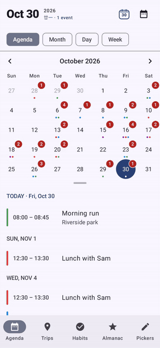
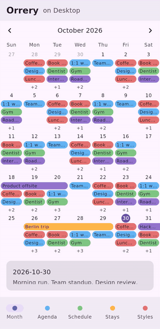
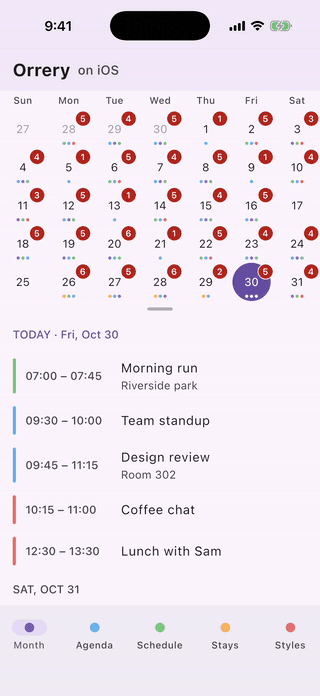
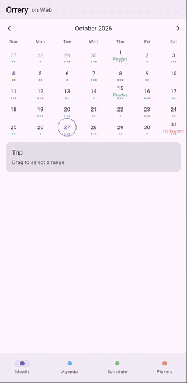

# Orrery

[](https://central.sonatype.com/artifact/me.kozakov.orrery/orrery-compose)
[](https://github.com/koza4e4ok/Orrery/actions/workflows/ci.yml)
[](https://developer.android.com/studio/releases/platforms)
[](LICENSE)

**Orrery is an Android calendar library for Jetpack Compose** — a fully
composable month/week/year calendar with Material 3 theming, flexible selection, and an
optional Chinese lunisolar module. It's distributed as Maven Central artifacts you add to
your app's Gradle dependencies (see [Installation](#installation)); there's no view
subclassing or XML.

It's a full rewrite of [CalendarView](https://github.com/huanghaibin-dev/CalendarView)
with composable slots instead of view subclassing, snapshot state instead of listener
interfaces, and an optional Chinese lunisolar artifact.

<p align="center">
  <a href="https://koza4e4ok.github.io/Orrery/demo/"><b>▶ Try the live demo in your browser</b></a>
  (Kotlin/Wasm, no install)
</p>

<p align="center">
  
</p>

The same tour on Desktop (JVM), iOS and Web (Kotlin/Wasm), rendered from one shared
Compose Multiplatform UI: trip range selection with holidays and paydays, Agenda, the
Day/Week schedule, and the range picker presets.

<p align="center">
  
  
  
</p>

**API reference:** [koza4e4ok.github.io/Orrery](https://koza4e4ok.github.io/Orrery/)
(Dokka, published for each release).

**Live demo:** [koza4e4ok.github.io/Orrery/demo](https://koza4e4ok.github.io/Orrery/demo/)
(the `demo/` module, deployed with the docs).

**Requirements:** Android `minSdk 23` · Jetpack Compose (Material 3) · Kotlin · JDK 17.
Built on [`kotlinx-datetime`](https://github.com/Kotlin/kotlinx-datetime).

## Installation

The library ships these artifacts on **Maven Central** under the group
`me.kozakov.orrery`:

| Artifact                           | Contents                                                                   |
| ---------------------------------- | -------------------------------------------------------------------------- |
| `me.kozakov.orrery:orrery-core`    | Pure-Kotlin calendar models, grid math and selection engine                |
| `me.kozakov.orrery:orrery-compose` | Jetpack Compose calendar composables with Material3 theming                |
| `me.kozakov.orrery:orrery-lunar`   | Chinese lunisolar calendar, solar terms and festivals as a DayInfoProvider |
| `me.kozakov.orrery:orrery-calendars` | Hijri (Umm al-Qura, tabular) and Persian calendars as DayInfoProviders |
| `me.kozakov.orrery:orrery-holidays` | Rule-based public holidays for US, GB, DE and UA as a DayInfoProvider |

> **Multiplatform:** `orrery-compose` also publishes Desktop (JVM), iOS
> and Web (`wasmJs`) variants. In a Kotlin Multiplatform project, add it to
> `commonMain` dependencies and Gradle picks the variant for each target.

`orrery-compose` already depends on `orrery-core`, so most apps only need the two
lines below. Make sure Maven Central is in your repositories (usually in
`settings.gradle.kts` under `dependencyResolutionManagement`):

```kotlin
// settings.gradle.kts
dependencyResolutionManagement {
    repositories {
        mavenCentral()
    }
}
```

```kotlin
// app/build.gradle.kts
dependencies {
    implementation("me.kozakov.orrery:orrery-compose:0.9.0")
    // Optional DayInfoProvider modules:
    implementation("me.kozakov.orrery:orrery-lunar:0.9.0")
    implementation("me.kozakov.orrery:orrery-calendars:0.9.0")
    implementation("me.kozakov.orrery:orrery-holidays:0.9.0")
}
```

Using a [version catalog](https://docs.gradle.org/current/userguide/version_catalogs.html)
(`gradle/libs.versions.toml`)?

```toml
[versions]
orrery = "0.9.0"

[libraries]
orrery-compose   = { module = "me.kozakov.orrery:orrery-compose",   version.ref = "orrery" }
orrery-lunar     = { module = "me.kozakov.orrery:orrery-lunar",     version.ref = "orrery" }
orrery-calendars = { module = "me.kozakov.orrery:orrery-calendars", version.ref = "orrery" }
orrery-holidays  = { module = "me.kozakov.orrery:orrery-holidays",  version.ref = "orrery" }
```

```kotlin
// app/build.gradle.kts
dependencies {
    implementation(libs.orrery.compose)
    implementation(libs.orrery.lunar) // optional
}
```

> **Snapshots:** development builds are published as `0.9.1-SNAPSHOT` to the Central
> snapshots repository. To use them, add
> `maven("https://central.sonatype.com/repository/maven-snapshots/")` to your repositories
> and depend on the `-SNAPSHOT` version.

## Quick start

```kotlin
@Composable
fun CalendarScreen() {
    val today = remember { currentDate() }
    val selection = rememberCalendarSelectionState(mode = SelectionMode.Range(maxDays = 14))
    val lunar = remember { LunarDayInfoProvider() } // optional, from orrery-lunar

    HorizontalCalendar(
        state = rememberCalendarState(),
        showWeekNumbers = true,
        dayContent = { day ->
            DefaultDay(
                day = day,
                selectionState = selection,
                today = today,
                info = lunar.info(day.date),
                decorators = listOf(
                    DayDecorators.eventDots { date -> eventColors[date].orEmpty() },
                    DayDecorators.progressRing { date -> habits[date] }, // 0f..1f
                ),
            )
        },
    )
}
```

The sample app (`sample/`) is five product-style screens: an Agenda with a
collapsible calendar and named events (switchable to Day and Week time grids), a Trips booking flow with drag-select,
nightly prices and blackout dates, a Habits tracker with streaks and animated
progress rings, an Almanac backed by `orrery-lunar`, `orrery-calendars` and `orrery-holidays`, and a Pickers screen
demonstrating all four picker dialogs.

## Features

- Month (`HorizontalCalendar`), vertical list (`VerticalCalendar`), single-week
  (`WeekCalendar`) and year-overview (`YearCalendar`) composables
- Unbounded (infinite) month/week scrolling with one-sided ranges
- `CollapsibleCalendarScaffold`: month collapses to a week row as the content scrolls
  or on a direct drag (optional `CollapsibleDragHandle`), with Month / TwoWeeks / Week
  snap stops; `ScrollSource` tells user drags from programmatic scrolls
- Two-week (`visibleWeeksCount = 1..4`) and work-week (`visibleDaysOfWeek`, e.g.
  Mon–Fri) modes, plus `CalendarRowHeight`
- Multi-day event title banners (`WeekEventBanners`) with `+N` overflow in the new
  `weekOverlay` slot, plus `weekFooter` / `monthFooter` slots
- Selection modes: single (with optional auto-advance), range (min/max), multi,
  plus long-press **drag-to-select**
- `OrreryDatePickerDialog` / `OrreryDateRangePickerDialog`: Material 3-shaped dialogs
  (slot-based confirm/dismiss buttons) with calendar and locale-aware text-input modes
- `OrreryDateTimePickerDialog`: date step, then a Material 3 time dial or keyboard
  input, returning a `LocalDateTime`
- `OrreryMonthPickerDialog`: month/year-only dialog (e.g. card expiry) on the
  `MonthYearPicker` grids
- First-class unavailable dates: `DisabledDates` (dates, ranges, days of week,
  before/after, predicates) blocks selection and renders disabled automatically
- Per-state day styling: `CalendarDayColors` + `CalendarDayShapes` with
  today-indicator variants (ring, filled, underline), segmented or banded
  in-range fills, optional selected-day elevation, and hospitality split range
  endpoints (`CalendarDefaults.hospitalityStyle()`: check-in PM / check-out AM halves,
  turnover days)
- Stackable day decorators: event dots, progress rings/bars, strikethrough,
  underline, and a GitHub-style heatmap — plus a raw `DayDecorator` DrawScope
  escape hatch
- `DaySchedule` / `WeekSchedule` 24-hour time-grid views: overlapping events
  packed side by side or stacked (`EventOverlapMode`, `layoutDaySchedule` in
  orrery-core), a working-hours `minHour..maxHour` window, spanning all-day banners,
  current-time line, pinch-to-zoom hour height, and tap callbacks for events
  and empty slots
- `HeatmapCalendar` contribution graph and `HeatmapMonth` heat tiles with
  active-day/streak summaries (`heatmapSummary` in orrery-core)
- `CalendarNavHeader` prev/next navigation with animated title and
  `MonthYearPicker` decade/year/month jump picker
- Scroll-to-today, selection haptics, range-fill animation, and
  keyboard/D-pad navigation with month-edge paging
- Flow observation (`visibleMonths`, `selectionChanges`), selection presets
  with a validated programmatic setter, count badges, and animated
  decorator values via `rememberAnimatedDayValues`
- Material3 theming — dark mode and dynamic color for free; all colors overridable
- Accessibility semantics, RTL mirroring, locale-driven names and first day of week
- Week numbers (ISO by default, custom `weekNumber` slot) and sticky month headers
- `orrery-lunar`: Gregorian↔lunar conversion (golden-tested against the original
  for all 73,049 days of 1900–2099), astronomical 24 solar terms, traditional and
  Gregorian festivals, 干支 year names, zh-CN/zh-TW/zh-HK string variants
- `orrery-calendars`: Hijri (Umm al-Qura 1300–1600 AH and tabular) and Persian
  (Jalali) conversions, checked day by day against java.time and ICU4J
- `orrery-holidays`: public holidays for US, GB, DE and UA (with subdivisions,
  substitute days and law changes by year), checked against python-holidays for
  2000–2050, plus your own rules for company calendars

## Usage

Everything below ships in `orrery-compose` unless marked otherwise. All dates are
[`kotlinx-datetime`](https://github.com/Kotlin/kotlinx-datetime) types (`LocalDate`,
`YearMonth`, `DayOfWeek`).

### Calendars

Five composables cover the common layouts. Each takes a state holder and a
`dayContent` slot; `DefaultDay` is the batteries-included cell, but the slot
accepts any composable.

| Composable                    | Layout                                                |
| ----------------------------- | ----------------------------------------------------- |
| `HorizontalCalendar`          | One month per page, swipe horizontally                |
| `VerticalCalendar`            | Continuous month list, optional sticky headers        |
| `WeekCalendar`                | Single week strip, one week per page                  |
| `YearCalendar`                | Year overview with a tappable mini-month grid         |
| `CollapsibleCalendarScaffold` | Month that collapses to a week row as content scrolls |

```kotlin
HorizontalCalendar(state = rememberCalendarState()) { day -> DefaultDay(day) }

VerticalCalendar(state = state, stickyMonthHeaders = true) { day -> DefaultDay(day) }

WeekCalendar(state = rememberWeekCalendarState()) { day -> DefaultDay(day) }

YearCalendar(onMonthClick = { month -> /* navigate */ })
```

`CollapsibleCalendarScaffold` pairs a month state with a week state and collapses
between them as its `content` scrolls (the Agenda screen in the sample):

```kotlin
CollapsibleCalendarScaffold(
    calendarState = rememberCalendarState(),
    weekState = rememberWeekCalendarState(startDate = start, endDate = end),
    dayContent = { day -> DefaultDay(day, selectionState = selection) },
) {
    LazyColumn { /* scrolling this collapses the month to a week row */ }
}
```

`HorizontalCalendar` and `WeekCalendar` also handle keyboard/D-pad navigation
(with month-edge paging) and animate height between 4/5/6-week months.

### Calendar state and navigation

`rememberCalendarState` pins the month range, the first visible month, the first
day of the week (locale-derived by default), and the `OutDateStyle` (how
leading/trailing cells fill). The state exposes scrolling as suspend functions
and the visible month as snapshot state:

```kotlin
val state = rememberCalendarState(
    startMonth = YearMonth(2020, 1),        // omit bounds for unbounded scrolling
    endMonth = YearMonth(2030, 12),         // null = open on that side
    outDateStyle = OutDateStyle.EndOfGrid,  // always six rows
)
val scope = rememberCoroutineScope()

state.firstVisibleMonth                       // snapshot-observable
scope.launch { state.animateScrollToToday() } // also: scrollToMonth, (animate)ScrollToDate
state.updateRange(newStart, newEnd)           // grow/shrink the range in place
```

Bounds are optional — the default state scrolls indefinitely in both
directions, and one-sided ranges (fixed past, open future) work too. Far
animated jumps teleport near the target before animating the landing, so
`animateScrollToMonth` five centuries away completes instantly.

`CalendarNavHeader` gives you prev/next chevrons around an animated title;
`MonthYearPicker` is a month/year/decade jump grid you can host in a dialog,
dropdown, or in place of the month grid:

```kotlin
CalendarNavHeader(state = state, onTitleClick = { showJumpPicker = true })

if (showJumpPicker) {
    MonthYearPicker(
        current = state.firstVisibleMonth,
        range = YearMonth(2020, 1)..YearMonth(2030, 12),
        onSelect = { month ->
            showJumpPicker = false
            scope.launch { state.scrollToMonth(month) }
        },
    )
}
```

Observe scrolling and selection as Flows — the sample's Agenda screen loads
events for whichever month scrolls into view:

```kotlin
LaunchedEffect(state) {
    state.visibleMonths().collect { month -> loadEvents(month) }
}
// also: WeekCalendarState.visibleWeeks(), CalendarSelectionState.selectionChanges()
```

### Selection

`rememberCalendarSelectionState` holds the selection and validates every change.
Pass it to `DefaultDay` (taps just work) and to a calendar's `dragSelection`
parameter for long-press drag-to-select ranges:

```kotlin
val selection = rememberCalendarSelectionState(
    mode = SelectionMode.Range(minDays = 2, maxDays = 14),
    disabled = blackoutDates,
    onEvent = { event ->
        // OutOfRange, Intercepted, RangeTooShort, RangeTooLong, TooManyDays
        snackbar("That stay is unavailable")
    },
)

VerticalCalendar(state = state, dragSelection = selection) { day ->
    DefaultDay(day, selectionState = selection)
}
```

Modes (`orrery-core`):

- `SelectionMode.Single(autoAdvance = false)` — one day; `autoAdvance` keeps a
  day selected while paging months (policy via `AutoSelectDay`)
- `SelectionMode.Range(minDays, maxDays)` — start/end range with inclusive
  day-count limits
- `SelectionMode.Multi(maxCount)` — toggle set, optionally capped
- `SelectionMode.Week(firstDayOfWeek = null, allowClear = true)` — a tap
  selects the whole 7-day week as a range; a null `firstDayOfWeek` follows the
  locale like the calendar does, so pass it only when the calendar overrides
  its own
- `SelectionMode.Month(allowClear = true)` — a tap selects the whole month as
  a range
- `SelectionMode.None` — display only

In `Week` and `Month` modes the period is clamped to `bounds`, a period that
contains a disabled day is rejected with `Intercepted`, tapping inside the
selected period clears it (unless `allowClear = false`), and long-press drag is
off. Programmatic writes (`set`, `initialSelection`) are snapped to the whole
week or month containing `rangeStart`.

Read and write programmatically — writes go through the same validation as taps,
so an invalid proposal is rejected and reported through `onEvent`:

```kotlin
selection.selection.range          // ClosedRange<LocalDate>? for Range mode
selection.set(SelectionPresets.nextWeekend(from = today)) // presets are pure factories
selection.clear()
```

`SelectionPresets` (in `orrery-core`) also has `nextDays`, `thisWeek`,
`thisMonth`, `lastNDays`, `thisQuarter`, and `workweek`.

### Disabled dates

`DisabledDates` is an immutable union built with a DSL. The selection engine
blocks these dates (single/multi taps, range endpoints, and any date inside a
proposed range) and `DefaultDay` renders them unavailable — no extra wiring:

```kotlin
val blackoutDates = DisabledDates {
    dates(LocalDate(2026, 12, 25))
    range(maintenanceStart..maintenanceEnd)
    daysOfWeek(DayOfWeek.SATURDAY, DayOfWeek.SUNDAY)
    before(currentDate())            // strictly before
    predicate { it.day == 13 }       // anything callable
}
```

### Day cells and theming

`DefaultDay` renders selection fill, in-range band, today indicator, a secondary
label (`info`), and stacked decorators. Colors and shapes come from two
immutable holders with Material 3 defaults:

```kotlin
DefaultDay(
    day = day,
    selectionState = selection,
    info = DayInfo(label = "$99"),        // small label under the day number
    showOutDates = false,                 // hide leading/trailing month days
    selectedElevation = 2.dp,
    colors = CalendarDefaults.dayColors(
        selectedContainerColor = MaterialTheme.colorScheme.tertiary,
    ),
    shapes = CalendarDefaults.dayShapes(
        dayShape = RoundedCornerShape(12.dp),
        inRangeShape = RoundedCornerShape(12.dp), // non-rect = segmented per-day fill
        todayIndicator = TodayIndicator.FilledCircle, // or Ring(width), Underline, None
    ),
    onClick = { day -> /* optional, in addition to selection */ },
)
```

`CalendarDayColors` covers every state (today, selected, in-range, out-date,
unavailable, label); anything you don't override follows the Material theme, so
dark mode and dynamic color work for free. The week header, week-number cell,
and month title are also slots — the defaults are `CalendarDefaults.WeekHeader`,
`CalendarDefaults.WeekNumber` (ISO week), and `CalendarDefaults.MonthTitle`.

### Decorators

Decorators draw data onto day cells without per-cell composables — they are
plain `DrawScope` lambdas keyed by date, stackable in one list:

```kotlin
val decorators = listOf(
    DayDecorators.eventDots { date -> eventColors[date].orEmpty() },
    DayDecorators.progressRing { date -> habitProgress[date] },   // 0f..1f
    DayDecorators.progressBar { date -> downloadProgress[date] },
    DayDecorators.badge { date -> unreadCount(date) },            // count bubble
    DayDecorators.heatmap { date -> activity[date] },             // GitHub-style
    DayDecorators.strikethrough { date -> date in cancelled },
    DayDecorators.underline { date -> date in deadlines },
)

DefaultDay(day = day, decorators = decorators)
```

Most factories are `@Composable` (they read theme colors) — call them once
outside `dayContent` and remember the list, not inside each cell. For anything
else, implement `DayDecorator` directly and draw with the full `DrawScope`;
`layer` picks `Behind` or `Over` the day number.

To animate decorator data, animate in composition and read the animated value in
the lookup — `rememberAnimatedDayValues` packages the idiom:

```kotlin
val animated = rememberAnimatedDayValues(habitProgress) // Map<LocalDate, Float>
DefaultDay(
    day = day,
    decorators = listOf(DayDecorators.progressRing(progress = animated)),
)
// when habitProgress[date] changes 0.4 -> 0.8, the ring eases over 300 ms
```

### Heatmaps

`HeatmapCalendar` is the GitHub-style contribution graph: one column per week
over any date range, scrolled to the most recent data, with month labels,
weekday labels, a legend, and a summary slot ("N active days · M-day streak",
computed by orrery-core's pure `heatmapSummary()`). `HeatmapMonth` is a static
month grid of the same tiles for dashboards. Both take the decorator-style
`intensity` lookup — null means no data — and an optional tap callback:

```kotlin
HeatmapCalendar(
    intensity = { date -> activity[date] },          // 0f..1f, null = empty cell
    state = rememberHeatmapCalendarState(),          // trailing 365 days by default
    onDayClick = { date -> showDetail(date) },
    strings = HeatmapDefaults.strings(legendLess = "Weniger", legendMore = "Mehr"),
)

HeatmapMonth(yearMonth = YearMonth(2026, 7), intensity = { activity[it] }, showDayNumbers = true)
```

The default color scale quantizes into five buckets from `surfaceVariant` to
`primary`; pass any `colorScale: (Float) -> Color` (a continuous lerp works
too). Cell accessibility descriptions bucket intensity into five spoken levels.

### Time-grid schedules

`DaySchedule` pages one day per swipe and `WeekSchedule` one week (`daysPerPage`,
default 7) per swipe. Both take the same `CalendarEvent` lookup as `Agenda`, share
a `ScheduleState` (visible date, vertical scroll, zoomable `hourHeight`), and
draw the current-time line only when you pass `currentTime`, so tests and
screenshots stay deterministic:

```kotlin
val events = remember(allEvents) { allEvents.eventsByDate(start..end) }
val state = rememberScheduleState(initialScrollTime = LocalTime(8, 0))

WeekSchedule(
    events = { date -> events[date].orEmpty() },
    state = state,
    currentTime = now, // from your own clock; null hides the line
    onEventClick = { event -> /* open */ },
    onEmptySlotClick = { date, time -> /* create at date/time */ },
)

scope.launch { state.scrollToTime(LocalTime(14, 0), density) }
```

Overlapping timed events split the column into lanes and widen into free lanes
to their right; overnight events are clipped to each day. The same packing is
available without Compose as `layoutDaySchedule(date, events)` in `orrery-core`.
Colors, sizes and every slot (day header, all-day chip, hour label, now line,
event tile) can be replaced through `ScheduleDefaults`.

### Date picker dialogs

M3-shaped dialog wrappers — `OrreryDatePickerDialog` (compact, single date) and
`OrreryDateRangePickerDialog` (full-screen, drag-select range) — with the same
`onDismissRequest`/`confirmButton` slot API as `androidx.compose.material3.DatePickerDialog`
(the compact dialog also takes a `dismissButton` slot; the range dialog dismisses via its
close glyph instead), plus a locale-aware text-input mode:

```kotlin
@Composable
fun PickDateButton() {
    var showDialog by remember { mutableStateOf(false) }
    val state = rememberOrreryDatePickerState()

    Button(onClick = { showDialog = true }) { Text("Pick date") }

    if (showDialog) {
        OrreryDatePickerDialog(
            onDismissRequest = { showDialog = false },
            confirmButton = {
                TextButton(
                    onClick = { showDialog = false },
                    enabled = state.selectedDate != null,
                ) { Text("OK") }
            },
            dismissButton = { TextButton(onClick = { showDialog = false }) { Text("Cancel") } },
            state = state,
        )
    }
}
```

Read `state.selectedDate` (or `selectedStartDate`/`selectedEndDate` on the range state) in
your confirm button. The state factories accept an initial date/range, a
`yearRange`, `disabledDates`, and (range only) `minDays`/`maxDays`; programmatic
writes are validated like taps. Both dialogs localize entirely through
`DatePickerStrings` — override any message via `DatePickerDefaults.strings(...)`.

```kotlin
val range = rememberOrreryDateRangePickerState(minDays = 2, disabledDates = blackoutDates)

OrreryDateRangePickerDialog(
    onDismissRequest = { showDialog = false },
    confirmButton = {
        TextButton(onClick = { save(range.selectedStartDate, range.selectedEndDate) }) {
            Text("Save")
        }
    },
    state = range,
    strings = DatePickerDefaults.strings(rangeTitle = "Select your stay"),
)
```

Add quick-pick chips above the range calendar with `presets`.
`DatePickerDefaults.rangePresets()` gives localized "Last 7 days", "Last 30 days",
"This week" and "This month" built from `SelectionPresets`; mix in your own
`DateRangePreset(label, range)`. A chip that breaks `minDays`/`maxDays`, bounds or
disabled dates is ignored on tap:

```kotlin
OrreryDateRangePickerDialog(
    onDismissRequest = { showDialog = false },
    confirmButton = { /* ... */ },
    state = range,
    presets = DatePickerDefaults.rangePresets() +
        DateRangePreset("Next 14 days", today..today.plus(13, DateTimeUnit.DAY)),
)
```

For a date and a time of day, `OrreryDateTimePickerDialog` shows the date picker
first, then **Next** opens a Material 3 time dial (with a keyboard toggle). Tap the
date or time in the headline to jump back. `bounds` and `disabled` restrict the date;
`is24Hour` defaults to the device's clock (the "Use 24-hour format" setting on Android,
the locale elsewhere), and the headline time is localized ("14:05", "2:05 PM",
"下午2:05"). Initial values are read once; write to `state.hour`, `state.minute` or
`state.is24Hour` to change them later. Pass `dateStrings` to localize the date step.
The result is a `LocalDateTime`, so attach the `TimeZone` you need:

```kotlin
val state = rememberOrreryDateTimePickerState(bounds = today..today.plus(90, DateTimeUnit.DAY))

OrreryDateTimePickerDialog(
    onDismissRequest = { showDialog = false },
    confirmButton = {
        TextButton(onClick = { book(state.selectedDateTime?.toInstant(TimeZone.currentSystemDefault())) }) {
            Text("Book")
        }
    },
    dismissButton = { TextButton(onClick = { showDialog = false }) { Text("Cancel") } },
    state = state,
)
```

For a month and year without a day, such as a card expiry date, use
`OrreryMonthPickerDialog`. It opens on the month grid of the selected (or current)
year; tap the year to zoom out to years and decades. Months outside `range` are
disabled, and `DatePickerDefaults.monthRange()` (the default) spans the current
year ±100:

```kotlin
val thisMonth = currentYearMonth()
val expiry = rememberOrreryMonthPickerState(range = thisMonth..thisMonth.plus(20, DateTimeUnit.YEAR))

OrreryMonthPickerDialog(
    onDismissRequest = { showDialog = false },
    confirmButton = {
        TextButton(
            onClick = { save(expiry.selectedMonth) },
            enabled = expiry.selectedMonth != null,
        ) { Text("OK") }
    },
    state = expiry,
)
```

### Day info and the lunar module

`DayInfoProvider` (in `orrery-core`) supplies a secondary per-day label —
holidays, prices, anything. `orrery-lunar` ships one for the Chinese lunisolar
calendar (valid 1900–2099), plus the underlying conversions:

```kotlin
val lunar = remember { LunarDayInfoProvider() } // or ChineseVariant.TRADITIONAL_TW / _HK

HorizontalCalendar(state = state) { day ->
    DefaultDay(day = day, info = lunar.info(day.date))
    // label priority: solar term > Gregorian festival > lunar festival > lunar day
}

date.toLunarDate()                  // Gregorian -> LunarDate (and back: toLocalDate())
solarTermsFor(2026)                 // Map<LocalDate, SolarTerm>, all 24 terms
SolarTerm.entries[0].displayName(ChineseVariant.SIMPLIFIED)
trunkBranchYear(2026)               // 干支 year name
```

Your own provider is one function:

```kotlin
val holidays = object : DayInfoProvider {
    override fun info(date: LocalDate): DayInfo? =
        publicHolidays[date]?.let { DayInfo(label = it, isHoliday = true) }
}
```


### Other calendars and public holidays

`orrery-calendars` labels days with Hijri or Persian dates, and `orrery-holidays`
marks public holidays. Both are `DayInfoProvider`s, so they compose with `+`;
the holiday wins the label and the other provider fills the rest:

```kotlin
val info = remember {
    PublicHolidayDayInfoProvider(PublicHolidays.forCountry("DE")!!, subdivision = "DE-BY", language = "de") +
        HijriDayInfoProvider(strings = HijriStrings.Arabic) // or PersianDayInfoProvider()
}

LocalDate(2026, 2, 18).toHijriDate()   // HijriDate(1447, 9, 1, UmmAlQura)
LocalDate(2026, 3, 21).toPersianDate() // PersianDate(1405, 1, 1)
PublicHolidays.forCountry("GB")!!.holidaysIn(2026, subdivision = "GB-SCT")
```

Umm al-Qura is a calculated calendar; dates announced after a moon sighting can
differ by a day, and holidays from Hijri rules are marked `isEstimated`. Build
your own `HolidayCalendar` (company days off) from the same `HolidayRule` types:
fixed dates, nth weekdays, Easter offsets (Western or Orthodox), Hijri or Persian
dates, one-off days, year ranges and weekend substitutes.

### Utilities

- `currentDate()` / `currentYearMonth()` — today in the system time zone
- `firstDayOfWeekFromLocale()` — locale-preferred first day of the week
- `DayOfWeek.displayName(narrow)`, `Month.displayName(short)`,
  `YearMonth.displayName()` — localized names
- `LocalDate.isoWeekNumber()` (`orrery-core`) — ISO-8601 week of year

### Using orrery-core without Compose

`orrery-core` is a plain Kotlin JVM library. `monthGrid`/`weekGrid` build the
day grids, `SelectionEngine` validates clicks and programmatic proposals as pure
functions, and `DisabledDates`/`SelectionPresets`/`daysOfWeek` work anywhere —
useful for view-based UIs, widgets, or server-side rendering.

## Development

```bash
# Full verification (what CI runs):
./gradlew ktlintCheck detekt checkKotlinAbi \
  :orrery-core:allTests :orrery-lunar:allTests :orrery-calendars:allTests :orrery-holidays:allTests \
  :orrery-compose:testDebugUnitTest :orrery-compose:verifyRoborazziDebug \
  :orrery-compose:desktopTest :orrery-compose:wasmJsTest \
  :sample:assembleDebug
./gradlew :orrery-compose:iosSimulatorArm64Test    # iOS tests (macOS only)

./gradlew :orrery-compose:recordRoborazziDebug  # refresh screenshot goldens
./gradlew updateKotlinAbi                          # refresh ABI dumps after API changes
```

`orrery-compose` is a Compose Multiplatform module targeting Android, Desktop
(`jvm("desktop")`), iOS (`iosArm64`, `iosSimulatorArm64`; Compose Multiplatform
has no Intel simulator build, so no `iosX64`) and Web (`wasmJs`). Locale-sensitive dates come from the platform: java.time on Android
and Desktop, `NSDateFormatter` on iOS, `Intl.DateTimeFormat` on Web. Built-in
strings are Android string resources on Android and bundled tables with the
same six languages elsewhere. Tests shared by Desktop, iOS and Web live in
`src/nonAndroidTest`; iOS klibs compile on Linux, but iOS tests need macOS.

On Android it uses the Android-KMP library plugin:
Android tests live in `src/androidHostTest`, and `testDebugUnitTest` /
`verifyRoborazziDebug` / `recordRoborazziDebug` are aliases for
`testAndroidHostTest` / `verifyRoborazziAndroidHostTest` /
`recordRoborazziAndroidHostTest`. To filter tests, call the real task, e.g.
`./gradlew :orrery-compose:testAndroidHostTest --tests "*DateInputFieldTest"`.

API docs: `./gradlew :dokkaGeneratePublicationHtml` writes the combined Dokka
site for `orrery-core`, `orrery-lunar`, `orrery-calendars`, `orrery-holidays` and `orrery-compose` to
`build/dokka/html`. The `Docs` workflow builds it on every `v*` tag (or by hand)
and deploys it to the [hosted API reference](https://koza4e4ok.github.io/Orrery/).

Releases are documented in [docs/RELEASING.md](docs/RELEASING.md).

## License

Apache License 2.0 — see [LICENSE](LICENSE). Ports algorithms and data tables from
[CalendarView](https://github.com/huanghaibin-dev/CalendarView) (Apache 2.0); see [NOTICE](NOTICE).
