# Orrery

[](https://central.sonatype.com/artifact/me.kozakov.orrery/orrery-compose)
[](https://github.com/koza4e4ok/Orrery/actions/workflows/ci.yml)
[](https://kotlinlang.org)

[](https://developer.android.com/studio/releases/platforms)
[](LICENSE)

**Compose Multiplatform calendars and date pickers for Android, iOS, Desktop and Web.**

Month, week and year calendars; single, range and multi selection with drag-to-select;
Material 3 date, range, date-time and month picker dialogs; day and week schedules
with an agenda; heatmaps; and optional Chinese lunar, Hijri, Persian and
public-holiday modules. Day cells are composable slots styled by your Material 3
theme, and dates are [`kotlinx-datetime`](https://github.com/Kotlin/kotlinx-datetime) types.

<p align="center">
  <a href="https://koza4e4ok.github.io/Orrery/demo/"><b>▶ Try the live demo in your browser</b></a>
  (Kotlin/Wasm, no install)
</p>

<p align="center">
  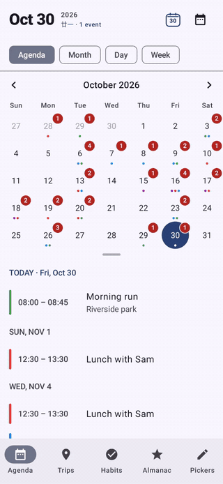
</p>

The shared Compose Multiplatform demo on Desktop (JVM), iOS and Web (Kotlin/Wasm):
multi-day week event banners, a collapsible Month / TwoWeeks / Week calendar over the
Agenda, a working-hours Day / Week schedule with stacked overlaps, hotel stays with split
check-in / check-out endpoints and turnover days, and the style presets under a Mon–Fri
two-week strip.

<p align="center">
  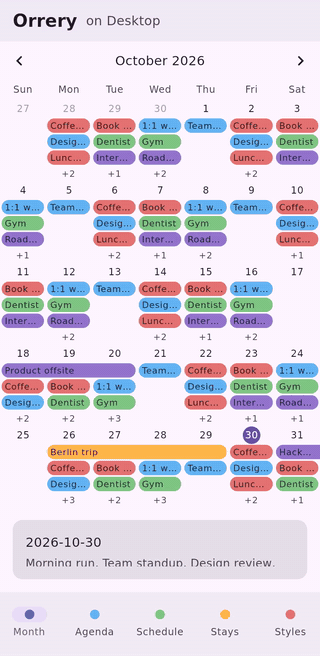
  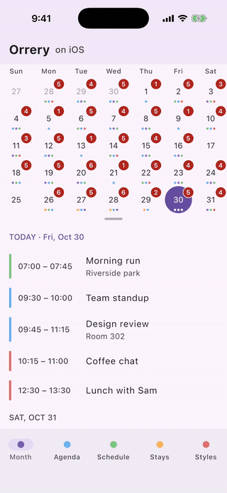
  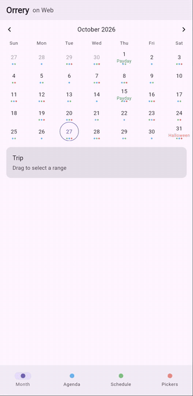
</p>

<details>
<summary><b>📸 Feature Screenshots Gallery (Collapsible Calendar, Event Banners, Range Styles, Progress Rings, Schedules, Year &amp; Heatmap, Style Presets, Pickers)</b></summary>
<br />

### Collapsible Calendar & Multi-Day Event Banners
Expanded `Month` with spanning `WeekEventBanners` (`+N` overflow), `TwoWeeks` mode with drag handle, collapsed `Week` strip, and Dark theme with lunisolar sub-labels & event count badges:

<p align="center">
  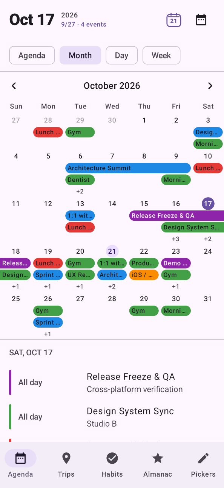&nbsp;&nbsp;
  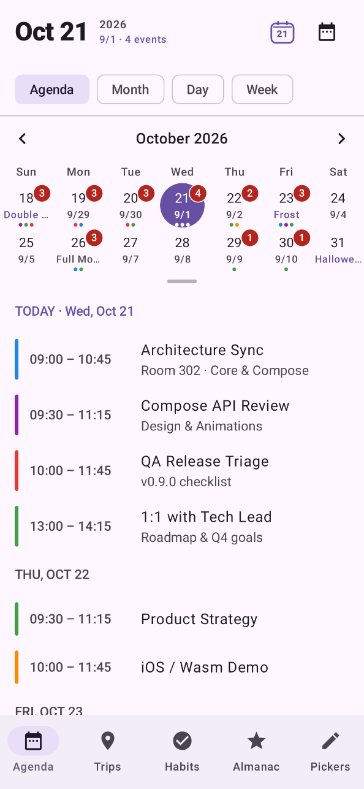&nbsp;&nbsp;
  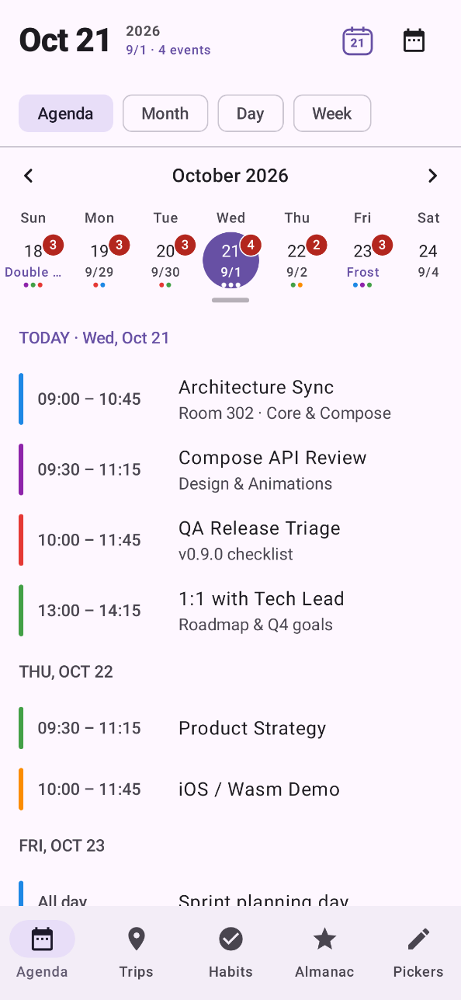&nbsp;&nbsp;
  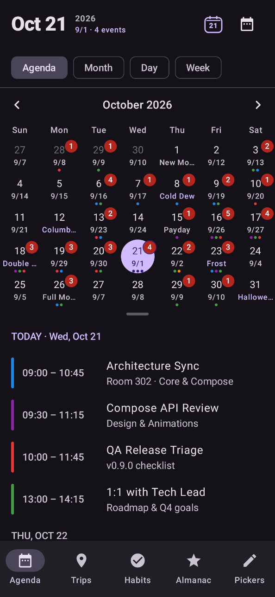
</p>

### Hospitality & Range Selection Styles
`SplitDiagonal` check-in/check-out triangles and `SplitHorizontal` half-cell endpoints with same-day turnover (`Oct 29`) and nightly pricing sub-labels:

<p align="center">
  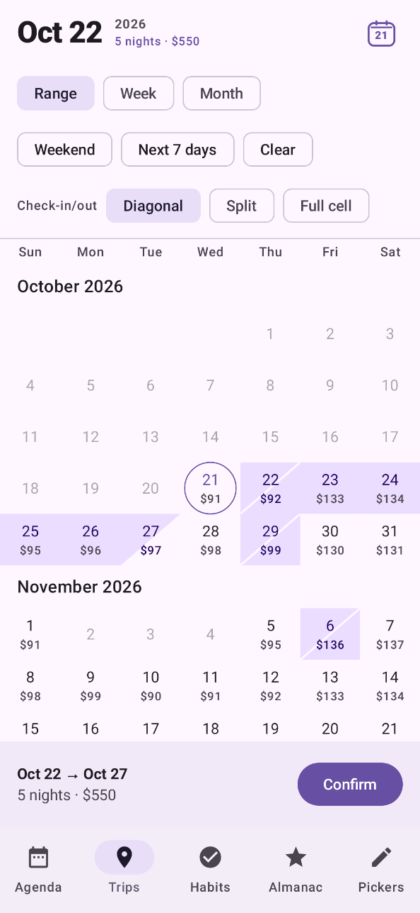&nbsp;&nbsp;
  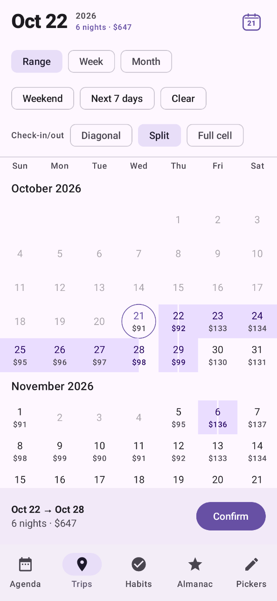
</p>

### Progress Rings & Weekday Filtering
Custom circular progress ring day cells across a `TwoWeeks` strip and `Month` grid, plus `visibleDaysOfWeek` (`Mon–Fri`) 5-column weekday filtering:

<p align="center">
  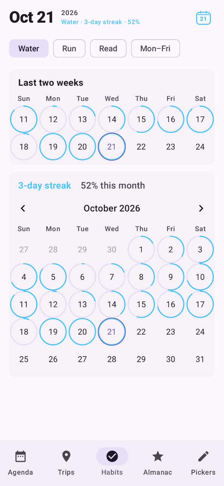&nbsp;&nbsp;
  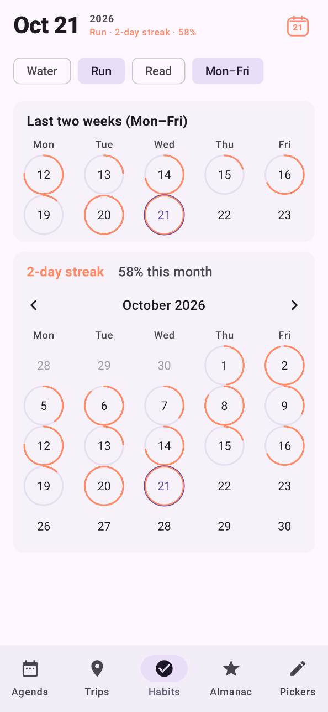
</p>

### Time-Grid Schedules (`WeekSchedule` & `DaySchedule`)
Working-hours `WeekSchedule` (`07:00–22:00`) with all-day banners, current-time indicator, and `SideBySide` timed event lanes, alongside `DaySchedule` with `EventOverlapMode.Stacked` cascading cards:

<p align="center">
  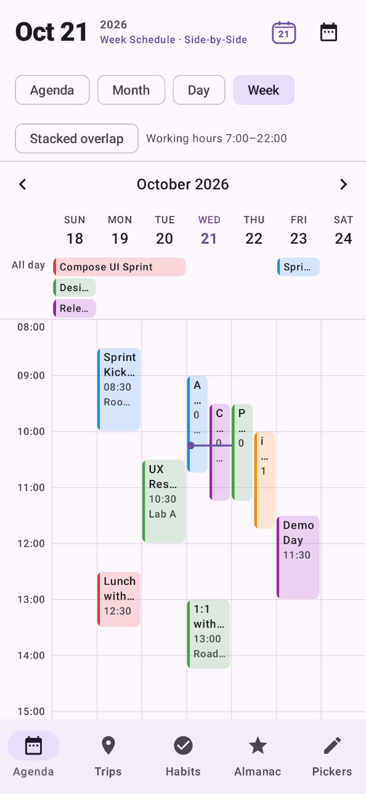&nbsp;&nbsp;
  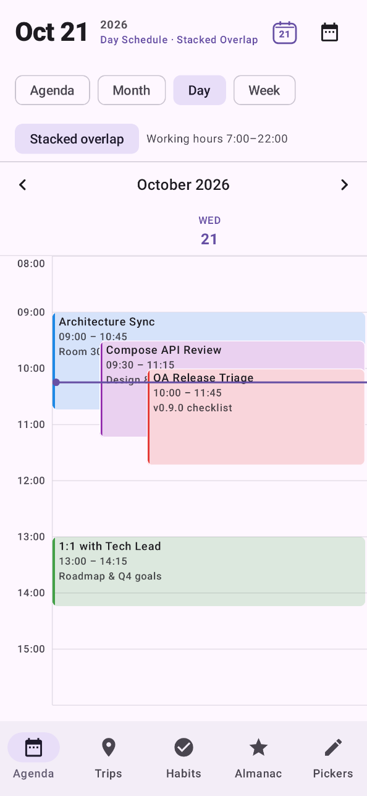
</p>

### Year View, Contribution Heatmap & Style Presets
12-month `YearCalendar` overview + GitHub-style `HeatmapCalendar`, and built-in `CalendarStyle` presets (`roundedSquareStyle`, `segmentedRangeStyle`, `borderedCardStyle` with Meizu `W`/`H` corner badges, and custom `DayDecorator` glow/festival styles):

<p align="center">
  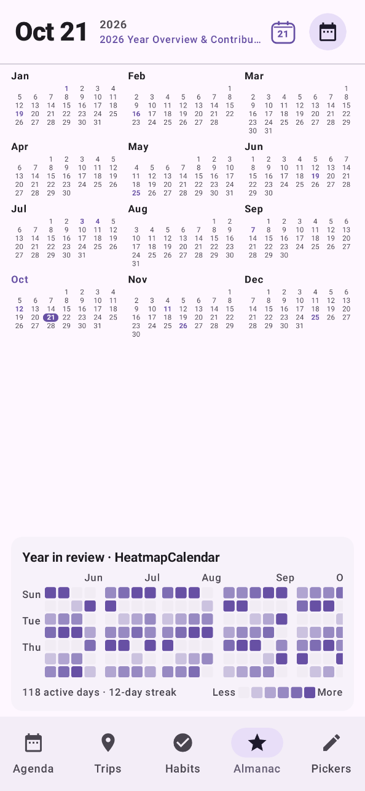&nbsp;&nbsp;
  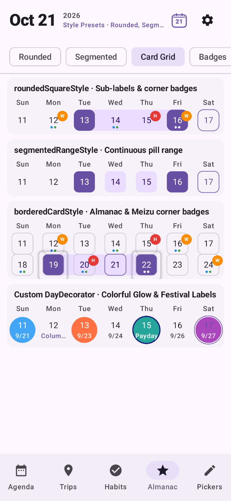
</p>

### Material 3 Date & Date-Range Picker Dialogs
Modal `OrreryDatePickerDialog` and full-screen `OrreryDateRangePickerDialog` with quick range preset chips:

<p align="center">
  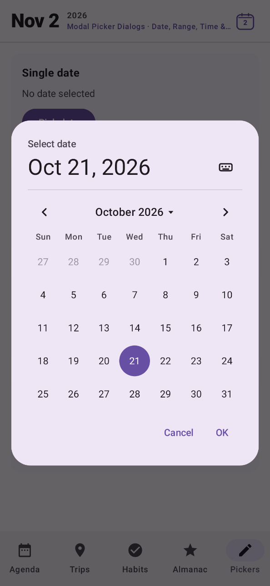&nbsp;&nbsp;
  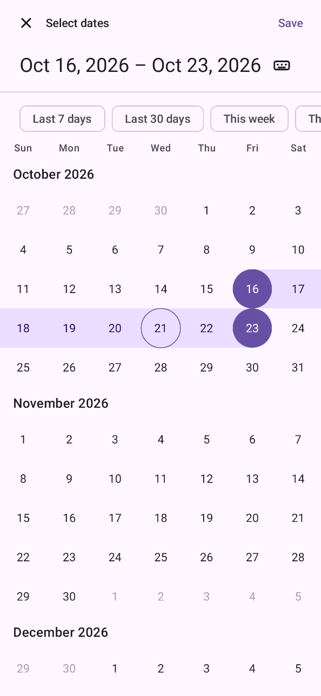
</p>

</details>

**[Guides](docs/guide/README.md)** · **[API reference](https://koza4e4ok.github.io/Orrery/)** ·
**[Live demo](https://koza4e4ok.github.io/Orrery/demo/)** · **[Changelog](CHANGELOG.md)** ·
**[Migrating from CalendarView](docs/migration/from-calendarview.md)**

## Why Orrery

| | Orrery | [kizitonwose/Calendar](https://github.com/kizitonwose/Calendar) | Material 3 `DatePicker` |
| --- | --- | --- | --- |
| Platforms | Android, iOS, Desktop, Web (Wasm) | Android, iOS, Desktop, Web (JS and Wasm) | Android, plus Compose Multiplatform |
| Android Views | Compose only | ✅ View and Compose artifacts | ✅ `MaterialDatePicker` |
| Month, week and year layouts | ✅ | ✅ | Month picker only |
| Ready-made day cells | ✅ `DefaultDay`, decorators, style presets | You design the cells (by design) | Fixed Material look |
| Selection | Built in and validated: single, range (min/max), multi, week, month, drag-to-select | You implement it on top of the day cells | Single or range |
| Disabled dates | `DisabledDates` DSL; blocks ranges that span them | ✅ | `SelectableDates` |
| Picker dialogs | Date, range with presets, date-time, month | – | Date and range (time picker is separate) |
| Day/week schedules and agenda | ✅ | – | – |
| Heatmap | ✅ | ✅ | – |
| Lunar, Hijri, Persian, public holidays | ✅ optional modules | – | – |
| Maturity | Pre-1.0, new | Mature, widely used | First-party |

Choose kizitonwose/Calendar if you need Android Views, Kotlin/JS or a long track
record, and Material 3's picker if a standard dialog is all you need. Orrery is for
when you want calendars, pickers and schedules that work out of the box and look
like the rest of your Material 3 app.

## Installation

The library ships these artifacts on **Maven Central** under the group
`me.kozakov.orrery`:

| Artifact                           | Contents                                                                   |
| ---------------------------------- | -------------------------------------------------------------------------- |
| `me.kozakov.orrery:orrery-core`    | Pure-Kotlin calendar models, grid math and selection engine                |
| `me.kozakov.orrery:orrery-compose` | Jetpack Compose calendar composables with Material3 theming                |
| `me.kozakov.orrery:orrery-lunar`   | Chinese lunisolar calendar, solar terms and festivals as a DayInfoProvider |
| `me.kozakov.orrery:orrery-calendars` | Hijri (Umm al-Qura, tabular) and Persian calendars as DayInfoProviders |
| `me.kozakov.orrery:orrery-holidays` | Rule-based public holidays for US, GB, DE and UA as a DayInfoProvider |

> **Multiplatform:** `orrery-compose` also publishes Desktop (JVM), iOS
> and Web (`wasmJs`) variants. In a Kotlin Multiplatform project, add it to
> `commonMain` dependencies and Gradle picks the variant for each target.

`orrery-compose` already depends on `orrery-core`:

```kotlin
// app/build.gradle.kts
dependencies {
    implementation("me.kozakov.orrery:orrery-compose:0.9.0")
    // Optional DayInfoProvider modules:
    implementation("me.kozakov.orrery:orrery-lunar:0.9.0")
    implementation("me.kozakov.orrery:orrery-calendars:0.9.0")
    implementation("me.kozakov.orrery:orrery-holidays:0.9.0")
}
```

Using a [version catalog](https://docs.gradle.org/current/userguide/version_catalogs.html)
(`gradle/libs.versions.toml`)?

```toml
[versions]
orrery = "0.9.0"

[libraries]
orrery-compose   = { module = "me.kozakov.orrery:orrery-compose",   version.ref = "orrery" }
orrery-lunar     = { module = "me.kozakov.orrery:orrery-lunar",     version.ref = "orrery" }
orrery-calendars = { module = "me.kozakov.orrery:orrery-calendars", version.ref = "orrery" }
orrery-holidays  = { module = "me.kozakov.orrery:orrery-holidays",  version.ref = "orrery" }
```

```kotlin
// app/build.gradle.kts
dependencies {
    implementation(libs.orrery.compose)
    implementation(libs.orrery.lunar) // optional
}
```

## Quick start

```kotlin
@Composable
fun TripCalendar() {
    val state = rememberCalendarState()
    val selection = rememberCalendarSelectionState(mode = SelectionMode.Range(maxDays = 14))

    Column {
        CalendarNavHeader(state = state)
        HorizontalCalendar(state = state, dragSelection = selection) { day ->
            DefaultDay(day, selectionState = selection)
        }
        Text(selection.selection.range?.let { "${it.start} – ${it.endInclusive}" } ?: "Pick your dates")
    }
}
```

Tap two days, or long-press and drag, to pick a range of up to 14 days. From here,
add [decorators](docs/guide/day-cells.md) for event dots or progress rings,
[disabled dates](docs/guide/selection.md#disabled-dates), or swap the calendar for a
[picker dialog](docs/guide/pickers.md).

The sample app (`sample/`) is five product-style screens: an Agenda with a
collapsible calendar and named events (switchable to Day and Week time grids), a Trips booking flow with drag-select,
nightly prices and blackout dates, a Habits tracker with streaks and animated
progress rings, an Almanac backed by `orrery-lunar`, `orrery-calendars` and `orrery-holidays`, and a Pickers screen
demonstrating all four picker dialogs.

## What's included

| Area | What you get | Guide |
| --- | --- | --- |
| Calendars | `HorizontalCalendar`, `VerticalCalendar`, `WeekCalendar`, `YearCalendar`; unbounded scrolling; two-week and work-week (e.g. Mon–Fri) modes; `CollapsibleCalendarScaffold` with Month / TwoWeeks / Week stops; week numbers, sticky month headers, `CalendarNavHeader`, keyboard and D-pad navigation; Flow observation of visible months | [Calendars](docs/guide/calendars.md) |
| Selection | Single (with auto-advance), range (min/max days), multi, week and month modes; long-press drag-to-select; `DisabledDates`; presets and validated programmatic writes; selection haptics | [Selection](docs/guide/selection.md) |
| Day cells and styling | `DefaultDay` with per-state colors and shapes, today indicators, segmented or banded range fills, hospitality check-in / check-out range endpoints, `CalendarStyle` presets | [Day cells](docs/guide/day-cells.md) |
| Decorators and heatmaps | Event dots, progress rings and bars, count badges, strikethrough, underline, custom `DrawScope` decorators, animated values; `HeatmapCalendar` and `HeatmapMonth` | [Day cells](docs/guide/day-cells.md) |
| Events | `DaySchedule` / `WeekSchedule` time grids (side-by-side or stacked overlaps, working-hours window, all-day banners, pinch-to-zoom, current-time line); `Agenda`; multi-day `WeekEventBanners` on month calendars | [Schedules](docs/guide/schedules.md) |
| Pickers | `OrreryDatePickerDialog`, `OrreryDateRangePickerDialog` with preset chips, `OrreryDateTimePickerDialog`, `OrreryMonthPickerDialog`; calendar and text-input modes | [Pickers](docs/guide/pickers.md) |
| Calendar systems | `orrery-lunar`: lunar dates (conversion golden-tested against CalendarView for every day of 1900–2099), 24 solar terms, festivals and 干支 years. `orrery-calendars`: Hijri (Umm al-Qura, tabular) and Persian, checked day by day against java.time and ICU4J. `orrery-holidays`: US, GB, DE and UA public holidays, checked against python-holidays for 2000–2050, plus your own rules | [Calendar systems](docs/guide/calendar-systems.md) |
| Platform and quality | Material 3 theming with dark mode and dynamic color; accessibility semantics; RTL; locale-driven names and first day of week; built-in strings in English, Ukrainian, German, Spanish, Simplified Chinese and Japanese | |

## Stability and compatibility

Orrery is pre-1.0, so public APIs can still change between minor versions. Every
change is listed in the [CHANGELOG](CHANGELOG.md), and CI checks the public API with
Kotlin's ABI validation (`checkKotlinAbi`), so API changes are always deliberate.

| Orrery | Kotlin | Compose Multiplatform | Compose BOM (Android) | kotlinx-datetime | Android `compileSdk` |
| --- | --- | --- | --- | --- | --- |
| 0.7.0 – 0.9.0 | 2.4.21 | 1.12.2 | 2026.09.00 | 0.8.0 | 37 |
| 0.6.0 | 2.4.0 | 1.11.1 | 2026.06.01 | 0.8.0 | 36 |

These are the versions each release was built against. Android apps need `minSdk 23`
and, from 0.7.0, `compileSdk 37` (Compose 1.12 requires it). Releases before 0.6.0
are Android-only.

> **Snapshots:** development builds are published as `0.9.1-SNAPSHOT` to the Central
> snapshots repository. To use them, add
> `maven("https://central.sonatype.com/repository/maven-snapshots/")` to your repositories
> and depend on the `-SNAPSHOT` version.

## Limitations

- Compose only: there are no Android View widgets. Host Orrery in a `ComposeView`, or
  use [`orrery-core`](docs/guide/core-without-compose.md) for the grid math and selection rules.
- Web means Kotlin/Wasm; there is no Kotlin/JS target. On iOS, `orrery-compose` ships
  arm64 device and Apple-silicon simulator builds, not `iosX64`.
- Hijri and Persian dates are labels on a Gregorian month grid, not separate month
  grids or pickers. Umm al-Qura dates are calculated, so dates announced after a moon
  sighting can differ by a day.
- Supported ranges: lunar 1900–2099, Umm al-Qura 1300–1600 AH (the tabular Hijri
  calendar is unbounded).
- Built-in public holidays cover the US, GB, DE and UA; other countries need custom rules.
- Schedule events can't be dragged or resized by the user.

## Contributing

Bug reports, questions and pull requests are welcome. See [CONTRIBUTING.md](CONTRIBUTING.md)
for how to build, test and send changes.

## License

Apache License 2.0 — see [LICENSE](LICENSE). Ports algorithms and data tables from
[CalendarView](https://github.com/huanghaibin-dev/CalendarView) (Apache 2.0); see [NOTICE](NOTICE).
